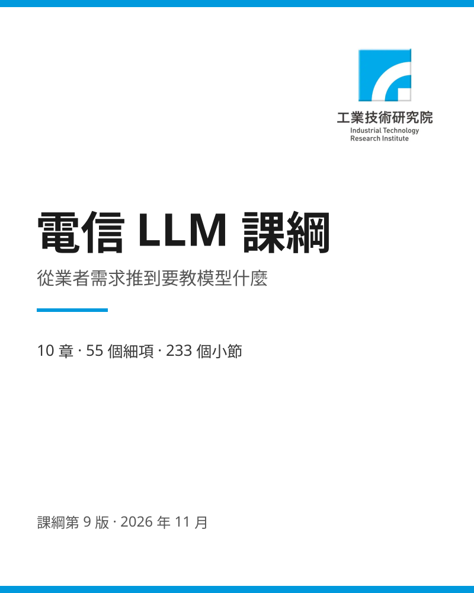

# 電信 LLM 課綱

學生是模型。業者有 7 類工作 → 做這些工作要 10 種能力 → 模型要上 10 章。

這份課綱要當電信公司的完整教本：業者工作上用得到的都要在裡面。每一章都從業者要做的工作推出來；GSMA 只拿來檢查有沒有漏，以及最後考一次。

- 學生：放得進業者機房的電信小模型（Telecom LLM）。
- 這本書的主體是課綱 10 章，分三層：章（U1）→ 細項（1.1）→ 小節（1.1.1）。小節目前只有標題，內容待補。
- GSMA Open Telco 評測放在附錄：它是用來檢查課綱有沒有漏、以及最後考一次的考試，不是開課的理由。

## 課綱一覽

| 章 | 名稱 |
|---|---|
| [U1](ch01/README.md) | 電信網路知識 |
| [U2](ch02/README.md) | 規格、條款與版本引用 |
| [U3](ch03/README.md) | 通訊原理與計算 |
| [U4](ch04/README.md) | 程式判讀 |
| [U5](ch05/README.md) | 告警與資料判讀 |
| [U6](ch06/README.md) | 障礙診斷與處置 |
| [U7](ch07/README.md) | 客服答覆與交接 |
| [U8](ch08/README.md) | 規劃與估算 |
| [U9](ch09/README.md) | 設定草案與變更檢查 |
| [U10](ch10/README.md) | 可靠與合規 |

GSMA Open Telco 的題目怎麼對應到各章，見[附錄 B](appendix/B-gsma-map.md)。

## 目錄

- [前言：課綱怎麼來的](intro.md)
- [第 1 章　電信網路知識](ch01/README.md)
  - [1.1 網路架構](ch01/1-1.md)
  - [1.2 通訊協定](ch01/1-2.md)
  - [1.3 服務與多媒體](ch01/1-3.md)
  - [1.4 網管、計費、安全與密碼學](ch01/1-4.md)
  - [1.5 開放與虛擬化](ch01/1-5.md)
  - [1.6 指標與名詞](ch01/1-6.md)
  - [1.7 網路優化與終端](ch01/1-7.md)
  - [1.8 維運組織](ch01/1-8.md)
  - [1.9 電信研究前沿](ch01/1-9.md)
- [第 2 章　規格、條款與版本引用](ch02/README.md)
  - [2.1 標準體系](ch02/2-1.md)
  - [2.2 規格文件的結構](ch02/2-2.md)
  - [2.3 表格與參數](ch02/2-3.md)
  - [2.4 文件歸類](ch02/2-4.md)
  - [2.5 業者文件](ch02/2-5.md)
  - [2.6 引用規則](ch02/2-6.md)
- [第 3 章　通訊原理與計算](ch03/README.md)
  - [3.1 訊號與通道](ch03/3-1.md)
  - [3.2 容量](ch03/3-2.md)
  - [3.3 鏈路預算](ch03/3-3.md)
  - [3.4 訊務與存取](ch03/3-4.md)
  - [3.5 基礎數理](ch03/3-5.md)
  - [3.6 解題方法](ch03/3-6.md)
  - [3.7 資訊理論與編碼](ch03/3-7.md)
- [第 4 章　程式判讀](ch04/README.md)
  - [4.1 讀懂程式](ch04/4-1.md)
  - [4.2 基地台軟體](ch04/4-2.md)
  - [4.3 維運腳本與設定檔](ch04/4-3.md)
  - [4.4 日誌與錯誤訊息](ch04/4-4.md)
- [第 5 章　告警與資料判讀](ch05/README.md)
  - [5.1 資料的種類](ch05/5-1.md)
  - [5.2 對齊資料](ch05/5-2.md)
  - [5.3 告警](ch05/5-3.md)
  - [5.4 指標趨勢](ch05/5-4.md)
  - [5.5 寫摘要](ch05/5-5.md)
- [第 6 章　障礙診斷與處置](ch06/README.md)
  - [6.1 根因的類型](ch06/6-1.md)
  - [6.2 推理](ch06/6-2.md)
  - [6.3 處置](ch06/6-3.md)
  - [6.4 流程](ch06/6-4.md)
  - [6.5 交接與報告](ch06/6-5.md)
- [第 7 章　客服答覆與交接](ch07/README.md)
  - [7.1 問題類型](ch07/7-1.md)
  - [7.2 拆出要核對的條件](ch07/7-2.md)
  - [7.3 答覆](ch07/7-3.md)
  - [7.4 追問與轉介](ch07/7-4.md)
  - [7.5 客訴轉網管](ch07/7-5.md)
- [第 8 章　規劃與估算](ch08/README.md)
  - [8.1 設定問題](ch08/8-1.md)
  - [8.2 和工具分工](ch08/8-2.md)
  - [8.3 解讀結果](ch08/8-3.md)
  - [8.4 方案與取捨](ch08/8-4.md)
- [第 9 章　設定草案與變更檢查](ch09/README.md)
  - [9.1 拆解意圖](ch09/9-1.md)
  - [9.2 參數](ch09/9-2.md)
  - [9.3 草案格式](ch09/9-3.md)
  - [9.4 變更前檢查](ch09/9-4.md)
  - [9.5 異動流程](ch09/9-5.md)
- [第 10 章　可靠與合規](ch10/README.md)
  - [10.1 不確定時](ch10/10-1.md)
  - [10.2 權限與資料](ch10/10-2.md)
  - [10.3 高風險操作](ch10/10-3.md)
  - [10.4 出處](ch10/10-4.md)
  - [10.5 資安規範](ch10/10-5.md)
- [附錄 A　GSMA Open Telco 七科介紹](appendix/A-gsma.md)
- [附錄 B　GSMA 題目對應課綱總表](appendix/B-gsma-map.md)
- [附錄 C　對應方法與規則](appendix/C-method.md)
- [附錄 D　來源與還沒補齊的地方](appendix/D-sources.md)

---
版本：課綱第 9 版（2026-11-23）；本書最後更新：2026-11-26 16:05。這本書由 `scripts/make_book.py` 從課綱網頁與標記檔產生，請改來源後重新產生，不要直接改這裡的檔案。
