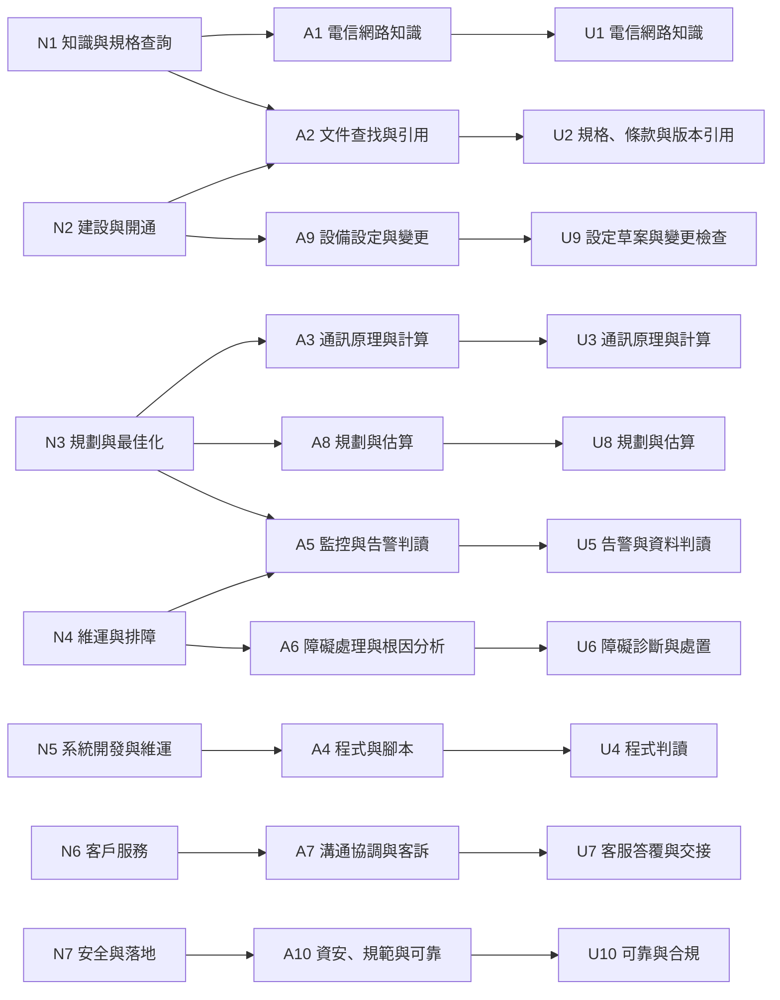

# 前言：課綱怎麼來的

需求是業者要做的工作；能力是業者徵人做這件工作時寫的條件；一種能力開一章。

## 需求：業者要做哪些工作

每一類工作列兩種憑據：這件工作確實存在，以及業者已經開始用 AI 做它。成效數字都是業者自己公布的。

| 需求 | 這件工作存在的憑據 | 已經導入 AI 的佐證 |
|---|---|---|
| N1 知識與規格查詢 | 中華電信門市同仁要查業務資訊才能受理；行動網路工程師的工作含「3GPP 標準研究」 | 中華電信門市智慧問答，受理與查詢效率提升約 27% |
| N2 建設與開通 | 中華電信 115 年招考「電信線路建設與維運」151 名；遠傳 5G 核心網職缺的工作含組態設定 | SoftBank 模型預測基地台設定，專家驗證準確率超過 90% |
| N3 規劃與最佳化 | 中華電信 115 年招考「電信網路規劃設計及維運」133 名；跨年前擴充基地台、容量提升近 40% | 中華電信結合生成式 AI 疏導訊務；台灣大用機器學習做流量分流 |
| N4 維運與排障 | 中華電信跨年由近千位工程師即時監控；遠傳網管中心三班輪值處理告警 | NTT DOCOMO 分析 100 萬台以上設備的告警，處理時間減少 50% 以上 |
| N5 系統開發與維運 | 中華電信 115 年招考有獨立的「資訊系統開發及維運」類組；中華電信推出商轉的 O-RAN 專網、整合虛擬化基地台 | 台灣大維運職缺把「用 AI 工具做監控、異常分析」列為加分 |
| N6 客戶服務 | 中華電信客服中心；台灣大集團電話客服職缺 | 中華電信 AI 智慧語音客服與值機應答助理 |
| N7 安全與落地 | 中華電信資訊網路維運職缺要求資安管理制度經驗 | NTT DOCOMO：系統提出建議，由維運工程師接手 |

## 能力：業者徵人時寫什麼條件

| 能力 | 職缺或考科怎麼寫 | 出現在哪 | 核對 |
|---|---|---|---|
| A1 電信網路知識 | 熟悉 TCP/IP；OSPF、BGP、MPLS VPN；3G/4G/5G 知識；4G/5G 核心網；網路功能虛擬化 | 中華電信、台灣大、遠傳 | 搜尋摘要 |
| A2 文件查找與引用 | 3GPP 標準研究 | 中華電信行動網路工程師 | 搜尋摘要 |
| A3 通訊原理與計算 | 專業科目：電腦網路與通信系統、基本電學、計算機概論 | 中華電信招考「電信網路規劃設計及維運」 | 已核對整理頁 |
| A4 程式與腳本 | 專業科目：程式設計概論；具備自動化腳本撰寫能力，熟悉 Shell Script 或 Python；程式開發能力尤佳 | 中華電信招考「資訊系統開發及維運」、台灣大、中華電信基地台職缺 | 前兩項已核對 |
| A5 監控與告警判讀 | 全天候監控網路與系統並處理告警；建置監控與告警機制；分析系統日誌 | 遠傳、台灣大 | 台灣大已核對 |
| A6 障礙處理與根因分析 | 一般與重大障礙處理流程；障礙通報流程管理；故障排除與根因分析 | 遠傳、中華電信、台灣大 | 台灣大已核對 |
| A7 溝通協調與客訴 | 電話溝通與協調能力；外部廠商與內部單位協調；處理帳單、收訊、客訴問題 | 遠傳、台灣大 | 搜尋摘要 |
| A8 規劃與估算 | 核心網路與無線接取網路的規劃設計；基地台設計、品質及效能優化；資源容量規劃 | 中華電信、台灣大 | 台灣大已核對 |
| A9 設備設定與變更 | 路由器、交換器、防火牆的設定與維運；核心網組態設定與流量路由管理；軟體版本更新；網路異動流程 | 遠傳、台灣大、中華電信 | 搜尋摘要 |
| A10 資安、規範與可靠 | 資安管理制度推動經驗；資安強化；ISO 27001 | 中華電信 | 搜尋摘要 |

沒收進課綱的一項。職缺裡還有「LLM 應用」（檢索增強生成、提示工程、微調），那是給做模型的人的條件。這份課綱的學生就是模型，不需要學這個。

## 課綱：十章與上課順序

| 順序上的決定 | 原因 |
|---|---|
| U1、U2、U3、U4 最先 | 知識、查規格、計算、讀程式是其他章都要用的基本功。A1 是出現在最多職缺的能力 |
| U3 和 U4 分成兩章 | 計算和讀程式是兩種不同的能力，分數要分開看 |
| U5 在 U6 前面，共用案例、分開考 | DOCOMO 的流程是先分析告警、再找故障點。考 U6 時直接給正確的時間軸，才分得出模型是讀錯資料還是推錯原因 |
| U8 在 U3 後面 | 規劃要用到計算。U3 教模型自己算基本題，U8 教怎麼設定問題、解讀工具的結果 |
| U9 排在實作類的最後 | 改錯設定的代價最高。SoftBank 也是專家驗證後才用 |
| U10 不單獨上課 | 「不確定就說、高風險等人核可」在每種工作都要做到，所以把這類樣本放進 U1～U9 的教材與考題，分數另外彙總 |

來源編號見[附錄 D](appendix/D-sources.md)。
